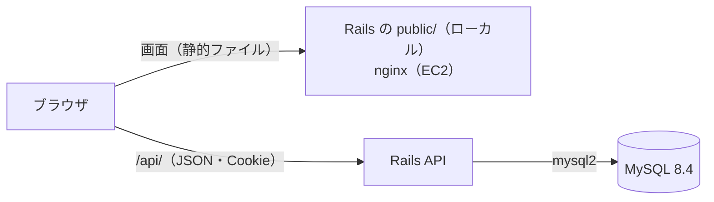
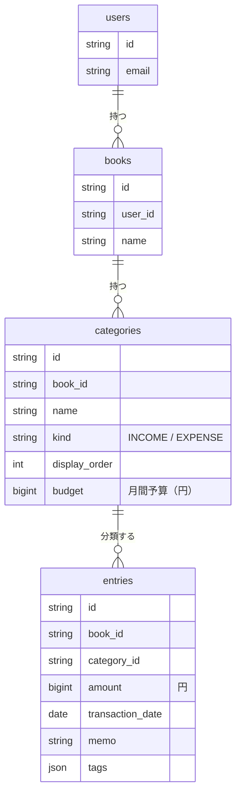

# 収支管理アプリ

カンバン式の個人向け収支管理アプリです。「袋分け家計簿」をカンバンで作るイメージで、列＝カテゴリ（給与・食費など）、カード＝1件のお金の出入りです。月ごとに収入・支出・残高がひと目でわかります。

[タスク管理アプリ（task-manager-app）](https://github.com/NakamuraKazki051/task-manager-app) をベースにしており、ログイン・カンバンの操作・データの出し入れ・AWSへのデプロイはそちらの仕組みを引き継いでいます。要件は [`docs/finance-app-requirements.md`](./docs/finance-app-requirements.md) を参照してください。今はフェーズ1（MVP: 取引の記録と月の集計）まで実装しています。

| 層 | 技術 |
|---|---|
| フロントエンド | Next.js 16（App Router）+ React 19 + TypeScript。静的ファイルに書き出して配信 |
| バックエンド | Ruby 4.0 + Ruby on Rails 8.1（API モード） |
| データベース | MySQL 8.4（ローカルは Docker、AWS は RDS for MySQL の無料枠） |

## 起動手順

Ruby 4.0（MSYS2 付き）と Node.js 24 が必要です（このPCでは `~/tools` に入っています。入れ方は [`backend/README.md`](./backend/README.md)）。

```
docker compose up -d           # MySQL コンテナを起動（リポジトリ直下で実行）
cd frontend
npm install
npm run build:rails            # 画面を書き出して backend/public/ にコピー
cd ../backend
bundle install
ruby bin/rails db:prepare      # DB を作ってマイグレーションを流す
ruby bin/rails server -p 8080  # 画面と API を配信
```

ブラウザで **`http://localhost:8080/`** を開いてください。バックエンドに接続できない場合は画面上部に赤いエラーバナーが表示されます。API の仕様は [`backend/README.md`](./backend/README.md)、画面の構成は [`frontend/README.md`](./frontend/README.md) を参照してください。

画面と API は同じオリジン（`http://localhost:8080`）で配信します。ログインの Cookie を別のオリジンから送らないためです。画面だけを書き換えながら確認するときは、Rails を起動したまま `frontend` で `npm run dev` を使うと、`http://localhost:3000/` から `/api/` が Rails へ中継されます。

MySQL のコンテナは 3306 番を使い、メモリの少ないPC向けに Docker Desktop の起動と同時には立ち上がらない設定です（使うときに `docker compose up -d`）。

## 使い方

1. `http://localhost:8080/` を開き、「新規登録」または「ログイン」する（初回ログイン時は「家計簿」と初期カテゴリ（「給与」「食費」「日用品」「交通費」「住居・光熱費」「その他」）が自動作成される）
2. 「+ 取引を追加」（スマホでは右下の「＋」）か、各列の下の「+ 収入を追加」「+ 支出を追加」から、金額・日付・カテゴリ・メモ・タグを入力して保存する。日付の初期値は今日（今月以外を表示中ならその月の1日）。収入か支出かはカテゴリで決まる
3. 画面上部の「◀ 2026年10月 ▶」で表示する月を切り替える。「今月」で今月に戻る。その横に、表示中の月の収入合計・支出合計・残高（収入−支出）が出る
4. 各列の見出しの下に、そのカテゴリの月の合計が出る。カードをドラッグ&ドロップすると別のカテゴリへ付け替えられる
5. カードをクリックすると編集・削除ができる。カードの右上の角のごみ箱アイコンからも、確認のあと取引を削除できる。カードのタグの「×」で、確認のあとそのタグだけを外せる（取引と他の取引のタグは残る）
6. 列見出しの「✎」でカテゴリ名を変更できる（金額は見出しではなく、取引として追加する）。名前部分のドラッグ&ドロップか◀▶ボタンで並べ替える。「収入」「支出」のラベルをクリックすると種別を切り替えられる（そのカテゴリの取引は、すべての月で新しい種別として集計される）
7. 末尾の「+ カテゴリを追加」で、名前と「収入/支出」を指定してカテゴリを作る。カテゴリを削除すると、そのカテゴリの取引もすべての月の分が削除される（確認あり）
8. 支出の列の「+ 予算を設定」で、そのカテゴリの月の予算を決める（毎月同じ額）。列に「予算 ¥30,000」「残り ¥12,000」と使った割合のバーが出て、予算を超えると「¥3,000 超過」と赤く表示される。予算の部分をクリックすると変更でき、空欄にすると予算を外せる
9. ヘッダーの検索欄でメモをキーワード検索、セレクトでタグ、金額欄で金額の範囲を絞り込む。絞り込み中は「この月のN件中 M件を表示（合計 ¥…）」と「条件をクリア」ボタンが出る
10. 「並び替え」で日付の新しい順／金額の大きい順を切り替える
11. ヘッダー左上の家計簿セレクトと+/✎/×ボタンで、家計簿（生活費・副業など）を複数作成・名前変更・削除できる。家計簿ごとにカテゴリと取引は独立している
12. 「☑ 選択」で選択モードに入り、カードをクリックして複数選択 →「選択した取引を削除」でまとめて削除（検索・絞り込みで見えていない取引は選択対象外。Escキーまたは「終了」で抜ける）
13. 「⚙ 設定・データ」メニューで、テーマ（自動/ライト/ダーク）の切り替え、カードの並び（縦: 取引を1列の一覧 / 横: カテゴリごとの列）の切り替え、家計簿のカテゴリ・取引（全期間）のJSONエクスポート/インポートと、取引のCSV出力（表示中の月／全期間。Excelでそのまま開ける）ができる
14. キーボードショートカット: `N` で取引を追加、`/` で検索欄へ移動、`Esc` でモーダル・メニュー・選択モードを閉じる。Tabキーでカードにフォーカスし、Enterで開く

## 機能

### アカウント
- メールアドレス・パスワードでのユーザー登録/ログイン/ログアウト（Cookieセッション、パスワードはBCryptでハッシュ化）
- アカウント設定からメールアドレス・パスワードを変更（現在のパスワードで本人確認）。パスワードを変更すると、他の端末・ブラウザはログアウトされる
- ログインが切れたときは、自動でログアウト状態の画面に戻り、再ログインを案内する
- 家計簿・カテゴリ・取引はユーザーごとに分離され、他ユーザーのデータにはアクセスできない

### 取引の記録（F-01, F-02）
- 金額（1〜99,999,999円の整数）・日付・カテゴリ・メモ（100文字まで）・タグを登録・編集・削除
- 金額は円の整数で保存し、合計はサーバー側で計算するので、端数の誤差が出ない
- 選択モードによる一括削除

### カテゴリ（F-03, F-04）
- 追加・名前変更・並べ替え・削除。カテゴリごとに「収入/支出」を設定（列の上端の色でも区別）
- 初回ログイン時・家計簿の作成時に初期カテゴリを自動作成

### 月間予算（F-10）
- 支出カテゴリごとに月の予算を設定（毎月同じ額、1〜99,999,999円）
- 表示中の月の残り額と使用率のバーを列に表示し、超過したら赤く表示
- JSONのエクスポート/インポートにも予算を含める

### 月の切り替えと集計（F-05, F-06）
- 表示する月の切り替え（前の月・次の月・今月）
- 月の収入合計・支出合計・残高を常時表示（残高がマイナスなら赤字で表示）。各カテゴリの月の合計を列見出しに表示

### 検索・並べ替え（F-07, F-08）
- メモのキーワード検索、タグ・金額の範囲での絞り込み
- 日付の新しい順／金額の大きい順の並べ替え

### 表示・データ
- テーマの手動切り替え（自動/ライト/ダーク）
- カードの並びを「縦（取引を日付順などの1列の一覧で表示）」と「横（カテゴリごとの列＝カンバン）」で切り替え（テーマと同じく、このブラウザに記憶）。一覧でもクリックで編集、選択モード、タグの「×」が使える
- スマホ幅に対応（列は縦に並び、取引の追加ボタンを画面右下に固定）
- JSONによるエクスポート/インポート（家計簿単位でのバックアップ・別環境への移行）
- CSV出力（F-09。表示中の月か全期間。列は日付・種別・カテゴリ・金額・メモ・タグ、BOM付きUTF-8でExcelでも文字化けしない）

## 技術構成



| 場所 | 役割 |
|---|---|
| `frontend/` | Next.js の画面（詳しくは `frontend/README.md`） |
| `backend/` | Rails API（Book / Category / Entry=取引）とテスト（詳しくは `backend/README.md`） |
| `docker-compose.yml` | ローカル用の MySQL コンテナ |
| `docs/finance-app-requirements.md` | 要件定義書 |
| `infra/terraform/` | AWS（EC2 + RDS for MySQL）環境 |
| `perf/e2e-perf.js` | E2E パフォーマンステスト（k6） |



## データ保存について

家計簿・カテゴリ・取引はすべてバックエンドAPI経由でMySQLに保存されます（ローカルは `docker-compose.yml` のコンテナ、データは名前付きボリューム `mysql-data`）。テーマ・カードの並び・「最後に開いていた家計簿」の記憶のみ、ブラウザの`localStorage`に保存される端末固有の表示設定です。別環境へデータを持ち出す場合は「エクスポート」でJSONを書き出し、移行先で「インポート」してください（インポートは現在の家計簿のデータを全置換します）。

```
docker compose up -d   # MySQL を起動（localhost:3306、ユーザー/パスワード: root / financemanager）
docker compose stop    # 停止（データはボリュームに残る）
```

## AWS（EC2）環境

`infra/terraform/` に、AWSの無料枠の範囲でEC2とRDS for MySQLを1台ずつ作るTerraformの設定があります。Rails は Docker イメージにして EC2 に送り、画面は nginx が配信します。作り方・費用の注意点は [`infra/terraform/README.md`](./infra/terraform/README.md) を参照してください。

## 今後の予定

要件定義書のフェーズ2の残り（集計グラフ。CSV出力・月間予算は実装済み）、フェーズ3（固定費の自動作成、予定と実績）を順に追加します。
