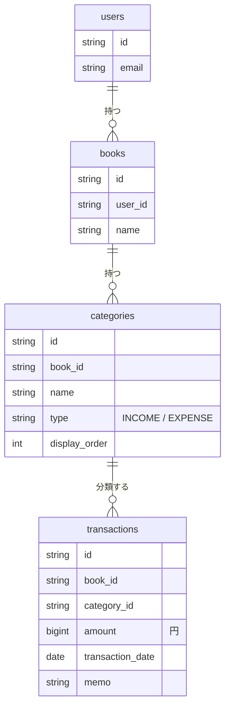

# 収支管理アプリ

カンバン式の個人向け収支管理アプリです。「袋分け家計簿」をカンバンで作るイメージで、列＝カテゴリ（給与・食費など）、カード＝1件のお金の出入りです。月ごとに収入・支出・残高がひと目でわかります。

[タスク管理アプリ（task-manager-app）](https://github.com/NakamuraKazki051/task-manager-app) をベースにしており、ログイン・カンバンの操作・データの出し入れ・AWSへのデプロイはそちらの仕組みを引き継いでいます。要件は [`docs/finance-app-requirements.md`](./docs/finance-app-requirements.md) を参照してください。今はフェーズ1（MVP: 取引の記録と月の集計）まで実装しています。

フロントエンド（`index.html`）はビルド不要ですが、データはバックエンドAPI（`backend/`、Spring Boot + PostgreSQL）に保存するため、**利用前にバックエンドとDBコンテナを起動しておく必要があります**。

## 起動手順

```
docker compose up -d   # PostgreSQLコンテナ起動（リポジトリ直下で実行）
cd backend
mvn package
java -Xmx256m -Xss512k -XX:MaxMetaspaceSize=128m -jar target/finance-manager-api-0.1.0.jar
```

ビルドと起動には JDK 25 が必要です。バックエンドが `http://localhost:8080` で起動した状態で、ブラウザで **`http://localhost:8080/`** を開いてください（`mvn package` 時にフロントエンド一式がバックエンドの静的リソースとして同梱されます）。バックエンドに接続できない場合は画面上部に赤いエラーバナーが表示されます。詳細な起動方法・API仕様は [`backend/README.md`](./backend/README.md) を参照してください。

DBコンテナはホストの5433番を使うので、タスク管理アプリのDB（5432番）と同時に起動しておけます。アプリ本体はどちらも8080番を使うため、バックエンドは片方ずつ起動してください。DBのデータはアプリごとに別のボリュームに保存されるので混ざりません。

**注意:** `index.html` を `file://` で直接（ダブルクリックで）開くと、ログイン機能が正しく動作しません。ブラウザはCookieのSameSite制限により、`file://` ページから `http://localhost:8080` への通信でセッションCookieを送信しないためです。必ず `http://localhost:8080/` 経由で開いてください。

## 使い方

1. `http://localhost:8080/` を開き、「新規登録」または「ログイン」する（初回ログイン時は「家計簿」と初期カテゴリ（給与・食費・日用品・交通費・住居・光熱費・その他）が自動作成される）
2. 「+ 取引を追加」（スマホでは右下の「＋」）から、金額・日付・カテゴリ・メモ・タグを入力して保存する。日付の初期値は今日（今月以外を表示中ならその月の1日）。収入か支出かはカテゴリで決まる
3. 画面上部の「◀ 2026年10月 ▶」で表示する月を切り替える。「今月」で今月に戻る。その横に、表示中の月の収入合計・支出合計・残高（収入−支出）が出る
4. 各列の見出しの下に、そのカテゴリの月の合計が出る。カードをドラッグ&ドロップすると別のカテゴリへ付け替えられる
5. カードをクリックすると編集・削除ができる
6. 列見出しをクリックするとカテゴリ名を変更できる。名前部分のドラッグ&ドロップか◀▶ボタンで並べ替える。「収入」「支出」のラベルをクリックすると種別を切り替えられる（そのカテゴリの取引は、すべての月で新しい種別として集計される）
7. 末尾の「+ カテゴリを追加」で、名前と「収入/支出」を指定してカテゴリを作る。カテゴリを削除すると、そのカテゴリの取引もすべての月の分が削除される（確認あり）
8. ヘッダーの検索欄でメモをキーワード検索、セレクトでタグ、金額欄で金額の範囲を絞り込む。絞り込み中は「この月のN件中 M件を表示（合計 ¥…）」と「条件をクリア」ボタンが出る
9. 「並び替え」で日付の新しい順／金額の大きい順を切り替える
10. ヘッダー左上の家計簿セレクトと+/✎/×ボタンで、家計簿（生活費・副業など）を複数作成・名前変更・削除できる。家計簿ごとにカテゴリと取引は独立している
11. 「☑ 選択」で選択モードに入り、カードをクリックして複数選択 →「選択した取引を削除」でまとめて削除（検索・絞り込みで見えていない取引は選択対象外。Escキーまたは「終了」で抜ける）
12. 「⚙ 設定・データ」メニューで、テーマ（自動/ライト/ダーク）の切り替え、家計簿のカテゴリ・取引（全期間）のJSONエクスポート/インポートができる
13. キーボードショートカット: `N` で取引を追加、`/` で検索欄へ移動、`Esc` でモーダル・メニュー・選択モードを閉じる。Tabキーでカードにフォーカスし、Enterで開く

## 機能

### アカウント
- メールアドレス・パスワードでのユーザー登録/ログイン/ログアウト（Cookieセッション、パスワードはBCryptでハッシュ化）
- アカウント設定からメールアドレス・パスワードを変更（現在のパスワードで本人確認）。パスワードを変更すると、他の端末・ブラウザはログアウトされる
- ログインが切れたときは、自動でログアウト状態の画面に戻り、再ログインを案内する
- 家計簿・カテゴリ・取引はユーザーごとに分離され、他ユーザーのデータにはアクセスできない

### 取引の記録（F-01, F-02）
- 金額（1〜99,999,999円の整数）・日付・カテゴリ・メモ（100文字まで）・タグを登録・編集・削除
- 金額は円の整数で保存し、合計はサーバー側で計算するので、端数の誤差が出ない
- 選択モードによる一括削除

### カテゴリ（F-03, F-04）
- 追加・名前変更・並べ替え・削除。カテゴリごとに「収入/支出」を設定（列の上端の色でも区別）
- 初回ログイン時・家計簿の作成時に初期カテゴリを自動作成

### 月の切り替えと集計（F-05, F-06）
- 表示する月の切り替え（前の月・次の月・今月）
- 月の収入合計・支出合計・残高を常時表示（残高がマイナスなら赤字で表示）。各カテゴリの月の合計を列見出しに表示

### 検索・並べ替え（F-07, F-08）
- メモのキーワード検索、タグ・金額の範囲での絞り込み
- 日付の新しい順／金額の大きい順の並べ替え

### 表示・データ
- テーマの手動切り替え（自動/ライト/ダーク）
- スマホ幅に対応（列は縦に並び、取引の追加ボタンを画面右下に固定）
- JSONによるエクスポート/インポート（家計簿単位でのバックアップ・別環境への移行）

## 技術構成

フロントエンドは素のHTML / CSS / JavaScriptのみで、フレームワークやビルドツールは使用していません。

| ファイル | 役割 |
|---|---|
| `index.html` | 画面構造 |
| `style.css` | スタイル |
| `app.js` | 表示中の月の取引・集計の取得と描画、バックエンドAPIとの通信 |
| `docs/finance-app-requirements.md` | 要件定義書 |
| `backend/` | Spring Boot REST API（Book / Category / Transaction） |
| `docker-compose.yml` | バックエンド用PostgreSQLコンテナ定義 |
| `infra/terraform/` | AWS（EC2 + RDS）環境 |
| `perf/e2e-perf.js` | E2E パフォーマンステスト（k6） |



## データ保存について

家計簿・カテゴリ・取引はすべてバックエンドAPI経由でPostgreSQLに保存されます（`docker-compose.yml`のDBコンテナ）。テーマと「最後に開いていた家計簿」の記憶のみ、ブラウザの`localStorage`に保存される端末固有の表示設定です。別環境へデータを持ち出す場合は「エクスポート」でJSONを書き出し、移行先で「インポート」してください（インポートは現在の家計簿のデータを全置換します）。

## PostgreSQLコンテナ（Docker）

リポジトリ直下の `docker-compose.yml` で、`backend/` のSpring Boot APIが使用するPostgreSQLコンテナ（`financemanager` データベース）を起動できます。

```
docker compose up -d   # 起動（localhost:5433、ユーザー/パスワード: financemanager）
docker compose stop    # 停止（データはボリュームに保持）
```

低メモリ環境向けに `postgres:16-alpine` を使用し、コンテナのメモリ上限を256MBに制限しています。

## AWS（EC2）環境

`infra/terraform/` に、AWSの無料枠の範囲でEC2とRDS（PostgreSQL）を1台ずつ作るTerraformの設定があります。作り方・費用の注意点は [`infra/terraform/README.md`](./infra/terraform/README.md) を参照してください。

## 今後の予定

要件定義書のフェーズ2（CSV出力、月間予算、集計グラフ）、フェーズ3（固定費の自動作成、予定と実績）を順に追加します。
