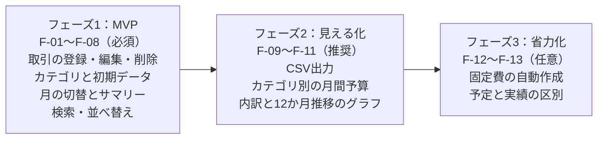

# 収支管理アプリ 要件定義書

2026-10-16 作成（原本: [Claude Docs](https://claude.ai/code/artifact/81c4a3ac-c92d-4d31-8987-e164c5f9f80a)）

## 1. 概要

既存のタスク管理アプリ（カンバン式）の土台をそのまま使い、日々の収入・支出を記録して月ごとの残高と使いみちが一目でわかる個人向け収支管理アプリを作る。

**ひとことで言うと：** 「袋分け家計簿」をカンバンで作る。列＝封筒（食費・日用品・給与など）、カード＝1件のお金の出入り。

| 項目 | 内容 |
| --- | --- |
| 目的 | 毎月いくら入って、何にいくら使い、いくら残ったかを把握する |
| 対象ユーザー | 個人（1ユーザー＝自分の家計）。家族共有はスコープ外 |
| ベースにする理由 | ログイン・ユーザー分離・ボード/列/カードのCRUD・D&D・エクスポート・EC2/RDSデプロイが既に動いており、作り直すより早く安全 |
| 通貨 | 日本円のみ（小数なし、整数で保持） |
| 成功の目安 | 1件の記録が10秒以内に終わる／月末に集計画面だけで収支がわかる |

## 2. 流用する既存資産

最初は構成（素のHTML/CSS/JS ＋ Spring Boot ＋ PostgreSQL ＋ EC2/RDS）をそのまま使い、「タスク」の部分だけを「取引」に置き換えた。2026-10-16 に、技術スタックを Next.js ＋ Ruby on Rails ＋ MySQL に切り替えた（API の形・画面の機能・EC2/RDS の運用はそのまま）。

| 既存機能 | 扱い | 収支アプリでの役割 |
| --- | --- | --- |
| アカウント（登録・ログイン・パスワード変更） | そのまま | 変更なし |
| ボード | 名前を変更 | **家計簿**（例：生活費、副業） |
| 列 | 意味を変更 | **カテゴリ**（収入/支出の種別を持つ） |
| タスク | 作り替え | **取引**（金額・日付・メモ） |
| ドラッグ&ドロップ | そのまま | 取引のカテゴリ付け替え |
| タグ、検索・絞り込み | そのまま | 「旅行」など横断的な分類、メモ検索 |
| 一括削除、JSONエクスポート/インポート | そのまま | バックアップ・移行 |
| テーマ切替、ショートカット、スマホ幅対応 | そのまま | 変更なし |
| 優先度・チェックリスト・期限超過表示・期限通知 | 削除 | 収支には不要 |
| 列の「完了扱い」 | 削除 | 「収入/支出」種別に置き換え |
| デプロイ（up/down/deploy.ps1、性能テスト） | そのまま | 変更なし |

タスク管理アプリのリポジトリを複製し、別アプリ（finance-manager-app）として並行運用する（2026-10-16 決定）。

## 3. 機能要件

最初のリリース（MVP）は「取引の記録」と「月の集計」だけ。予算やグラフはその後に足す。

優先度：**必須**＝MVPに入れる、**推奨**＝第2段階、**任意**＝余裕があれば

| ID | 機能 | 内容 | 優先度 |
| --- | --- | --- | --- |
| F-01 | 取引の登録 | 金額（1〜99,999,999円）・日付（初期値＝今日）・カテゴリ・メモ・タグを入力。収入か支出かはカテゴリで決まる | 必須 |
| F-02 | 取引の編集・削除 | カードを開いて編集・削除。選択モードで一括削除 | 必須 |
| F-03 | カテゴリ管理 | 追加・名前変更・並べ替え・削除。各カテゴリに「収入/支出」を設定。取引が残っているカテゴリは削除時に確認を出す | 必須 |
| F-04 | 初期カテゴリ | 初回ログイン時に「給与」「食費」「日用品」「交通費」「住居・光熱費」「その他」を自動作成 | 必須 |
| F-05 | 月の切替 | 画面上部の「◀ 2026年10月 ▶」で表示する月を選ぶ。カンバンはその月の取引だけを表示 | 必須 |
| F-06 | 月のサマリー | 収入合計・支出合計・差引（残高）を画面上部に常時表示。各列の見出しにカテゴリ合計 | 必須 |
| F-07 | 検索・絞り込み | メモのキーワード、タグ、金額範囲で絞り込み | 必須 |
| F-08 | 並べ替え | 列内を日付順（新しい順）／金額順で表示 | 必須 |
| F-09 | エクスポート/インポート | 既存のJSONに加え、CSV出力（Excelで開ける） | 推奨（CSV出力は実装済み） |
| F-10 | 月間予算 | 支出カテゴリごとに予算額を設定し、列見出しに「残り…円」を表示。超過で赤表示 | 推奨 |
| F-11 | 集計レポート | カテゴリ別の内訳と、過去12か月の収支推移をグラフ表示 | 推奨 |
| F-12 | 固定費の繰り返し | 家賃・サブスクなどを「毎月…日」で登録し、月が変わると自動で取引を作成 | 任意 |
| F-13 | 予定と実績 | 取引に「予定/確定」を持たせ、予定は集計で別表示（既存の完了チェックを流用） | 任意 |

## 4. データ設計

テーブル構成は既存と同じ「ユーザー → ボード → 列 → カード」の4段。変わるのは列とカードの中身だけ。

### Task → Transaction（取引）の対応

| 既存の項目（Task） | 新しい項目（Transaction） | 型 | 備考 |
| --- | --- | --- | --- |
| id / boardId / columnId | id / bookId / categoryId | 文字列 | 名前のみ変更 |
| title | memo | 文字列（100字まで） | 任意。空ならカードにカテゴリ名を表示 |
| description | ― | ― | 削除（memoに統合） |
| （なし） | **amount** | 整数（BIGINT、円） | 必須。1以上。符号は持たず、収入/支出はカテゴリで判定 |
| dueDate | **date**（取引日） | 日付 | 必須。月の絞り込みに使うためインデックスを張る |
| categories | tags | 文字列のリスト | そのまま |
| completed | confirmed | 真偽値 | F-13で使う。MVPでは常にtrue |
| createdAt / displayOrder | そのまま | ― | ― |
| priority / checklistItems | ― | ― | 削除 |

### BoardColumn → Category（カテゴリ）

| 既存の項目 | 新しい項目 | 型 | 備考 |
| --- | --- | --- | --- |
| name / displayOrder | そのまま | ― | ― |
| done | **type** | 列挙型（INCOME / EXPENSE） | 必須 |
| （なし） | budget | 整数（円、空可） | F-10で使う |

金額は小数誤差を避けるため必ず整数で持ち、集計はDB側（SQLのSUM）で行う。既存は `ddl-auto: update` なので、列の削除・型変更を伴う今回は新しいDBで始めるのが安全。

## 5. 画面・API一覧

画面は既存の1画面構成を維持し、上部に「月切替＋サマリー」の帯を足すだけ。

### 画面

| 画面 | 主な表示・操作 | 既存からの変更 |
| --- | --- | --- |
| ログイン/新規登録 | メール・パスワード | なし |
| メイン（カンバン） | 月切替、収入/支出/残高サマリー、カテゴリ列（収入列を左、支出列を右）、取引カード | サマリー帯を追加、カードに金額を大きく表示 |
| 取引モーダル | 金額・日付・カテゴリ・メモ・タグ | 優先度・チェックリスト欄を削除、金額欄を先頭に |
| カテゴリ追加/編集 | 名前、収入/支出、（予算） | 「完了扱い」を「収入/支出」に変更 |
| レポート（推奨） | カテゴリ内訳、12か月推移 | 新規 |
| 設定・データ | テーマ、JSON/CSVの出入力、アカウント | 通知設定を削除、CSVを追加 |

### API（変更・追加分のみ）

| メソッド | パス | 内容 |
| --- | --- | --- |
| GET | `/api/books/{bookId}/transactions?month=2026-10` | 指定月の取引一覧 |
| POST | `/api/books/{bookId}/transactions` | 取引を登録 |
| PUT / DELETE | `/api/transactions/{id}` | 取引を更新／削除 |
| PATCH | `/api/transactions/{id}/move` | カテゴリ付け替え・並び替え（既存moveを流用） |
| POST | `/api/books/{bookId}/transactions/bulk-delete` | 一括削除（既存を流用） |
| GET | `/api/books/{bookId}/summary?month=2026-10` | 収入合計・支出合計・残高・カテゴリ別合計 |
| GET | `/api/books/{bookId}/summary/monthly?from=2025-11&to=2026-10` | 月別推移（推奨） |
| GET | `/api/books/{bookId}/export.csv?month=2026-10` | CSV出力（推奨） |

`/api/auth`、`/api/users`、ボード・列のCRUDはパス名（boards→books、columns→categories）以外そのまま。他ユーザーのデータには既存と同様404を返す。

## 6. 非機能要件

基本は既存アプリの水準を維持し、お金のデータなので「金額の正確さ」と「消えないこと」を一段厳しくする。

| 区分 | 要件 |
| --- | --- |
| 正確さ | 金額は整数で保持し、画面の合計とAPIの集計が1円もずれない。表示は3桁カンマ区切り（例：¥123,456） |
| 入力チェック | 金額・日付・カテゴリはサーバー側でも検証し、不正値は400を返す |
| 性能 | 1か月500件までの表示と集計が1秒以内。既存の `perf.ps1` に取引シナリオを追加して計測 |
| セキュリティ | 既存と同じ（BCrypt、Cookieセッション、ユーザー分離、HTTPSはnginx経由） |
| バックアップ | RDSの自動バックアップを有効にする。利用者側でもJSON/CSVで手元に保存できる |
| 運用 | 既存の up/down/deploy.ps1 でEC2＋RDSを必要なときだけ起動。`down` でもDBのデータは消さない |
| 対応環境 | PCのChromeとスマホ幅。スマホでは「＋取引追加」ボタンを画面下部に固定 |
| テスト | 各APIのコントローラーテスト（既存と同形式）、集計の境界値（月初・月末・うるう年2月29日）、他ユーザーのデータに触れないこと |

## 7. 開発ステップとスコープ外

3段階で作り、各フェーズはゴールを満たしたら次へ進む。フェーズ1だけで家計簿として使える状態になる。

| フェーズ | ゴール |
| --- | --- |
| 1：MVP | 実際に1か月記録できる |
| 2：見える化 | 予算超過に気づける |
| 3：省力化 | 入力の手間が減る |

フェーズ1の作業は「新リポジトリ作成 → Task/Columnの置き換え（DB・API・テスト） → 画面の置き換え → EC2へデプロイ」の順。

**スコープ外（今回はやらない）**

- 銀行・クレジットカード・電子マネーとの自動連携
- レシート撮影による自動入力
- 家族など複数ユーザーでの家計簿共有
- 外貨・複数通貨
- スマホアプリ（ブラウザで使う）
